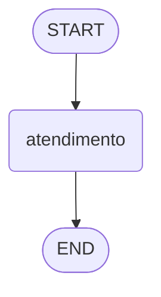

# Desafio 1 · A recepção lembra de cada conversa

Código: [recepcao.py](recepcao.py)

## Desenho do fluxo



```text
  START ──► atendimento ──► END
              │
              └─ lê state["messages"] (histórico da thread) e devolve {"messages": [resposta_nova]}

  MemorySaver guarda um histórico por thread_id:
    "recepcao_ana"   → [Ana: ABC1D23, resposta, pergunta, resposta, + "visita sexta" (update_state)]
    "recepcao_bruno" → [Bruno: XYZ9A87, resposta, pergunta, resposta]
```

## Decisões

| Item | Escolha | Por quê |
|---|---|---|
| Estado | `messages: Annotated[list, add_messages]` | O reducer acrescenta a resposta ao histórico em vez de trocar a lista. |
| Nó | `atendimento` devolve só `[resposta]` | Quem junta ao histórico é o `add_messages`. |
| Memória | `MemorySaver` + `thread_id` por pessoa | Mesmo grafo, conversas separadas pela configuração. |
| Correção manual | `update_state(config_ana, {...})` | Grava o fato na sessão sem chamar o modelo. |
| Modelo | Simulado por padrão; `--real` usa `gpt-4o-mini` | Testar a organização do histórico sem custo de API. |

## Registro das verificações (execução em 22/11/2026, modo simulado)

```text
Ana   > Qual veículo? Você está acompanhando o veículo ABC1D23.
Bruno > Qual veículo? Você está acompanhando o veículo XYZ9A87.

Snapshot Ana: 4 -> 5 mensagens | última: HumanMessage: 'A visita será na sexta-feira'
Snapshot Bruno: 4 -> 4 mensagens
Ana   > Quando será a visita? A visita será na sexta-feira.
Bruno > Quando será a visita? Não há visita registrada nesta conversa.

  [OK] Ana recupera o próprio veículo (ABC1D23)
  [OK] Bruno recupera o próprio veículo (XYZ9A87)
  [OK] Resposta de Ana não cita o veículo de Bruno
  [OK] Sessão de Bruno não contém dados de Ana
  [OK] update_state acrescentou 1 mensagem só na Ana (sem resposta do modelo)
  [OK] Após o update, a Ana responde com a sexta-feira
  [OK] Bruno não sabe da visita da Ana
  [OK] Novo MemorySaver começa vazio (memória NÃO é durável)
```

- **A atualização aparece antes de uma nova resposta:** o snapshot da Ana passa de 4 para 5 mensagens e a última é a `HumanMessage` inserida; não há `AIMessage` nova, então o modelo não foi chamado.
- **Bruno isolado:** a sessão dele continua com 4 mensagens, sem `ABC1D23` e sem “sexta”.

## Teste manual no modo `--chat` (22/11/2026, modelo simulado)

Roteiro executado por mim no terminal, uma linha por vez. Todos os passos deram o resultado esperado.

| O que testei | Resultado |
|---|---|
| Ana pergunta o veículo antes de informar | "Não encontrei nenhum veículo nesta conversa." |
| Ana informa ABC1D23 e pergunta | "Você está acompanhando o veículo ABC1D23." |
| `/sessao bruno` e pergunta o veículo | "Não encontrei…" (não enxerga a Ana) |
| Bruno informa XYZ9A87 e pergunta | "…XYZ9A87." |
| Volta para Ana e pergunta | "…ABC1D23." (continua lembrando) |
| `/fato A visita será na sexta-feira` + `/estado` | 9 mensagens; a última é a `HumanMessage` do fato, sem `AIMessage` depois (modelo não chamado) |
| Ana: "Quando será a visita?" | "A visita será na sexta-feira." |
| Bruno: "Quando será a visita?" + `/estado` | "Não há visita registrada…"; snapshot sem ABC1D23 e sem "sexta" |
| `/sair`, abrir de novo, Ana pergunta o veículo | "Não encontrei nenhum veículo…" (memória perdida ao reiniciar) |

Durante testes anteriores, o modelo simulado errou frases escritas de outro jeito ("veiculo" sem acento, "visita vai ser", "na verdade vai ser"). Ajustei as regras, mas isso reforça o limite: ele segue padrões fixos, não entende texto.

## Limites

- **Modelo simulado:** a regra fixa procura a placa/dia no histórico recebido. O teste prova que cada thread entrega o histórico certo ao nó, **não** demonstra compreensão real de uma LLM. Com `--real`, as respostas mudam de texto e as checagens por palavra-chave podem precisar de ajuste.
- **Não é persistência durável:** `MemorySaver` guarda tudo na RAM do processo. Um novo `MemorySaver` (ou reiniciar o script) começa vazio, como mostra a última verificação.
