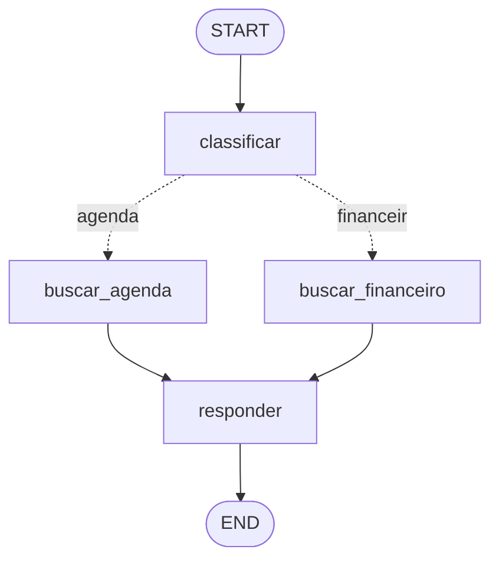

# Desafio 2 · A secretária consulta o manual certo

Código: [secretaria_router.py](secretaria_router.py)

Uma pergunta de **um único domínio** por vez é classificada como `agenda` ou
`financeiro`; só a base correspondente é consultada e a resposta usa os
documentos recuperados. Regras fictícias; sem cadastro, agenda real ou cobrança.

## Desenho do grafo



Setas tracejadas = `add_conditional_edges("classificar", escolher_rota)`.
As duas rotas convergem para um único nó `responder`.

## Decisões

| Item | Escolha | Por quê |
| --- | --- | --- |
| Estado interno | `SecretariaState`: pergunta, dominio, documentos, resposta | Os nós compartilham tudo, inclusive o domínio. |
| Contrato público | `input_schema=Entrada` (pergunta) e `output_schema=Saida` (documentos, resposta) | Quem chama não envia nem recebe o domínio interno. |
| Classificação | `RouteDecision` com `Literal["agenda", "financeiro"]` + `with_structured_output` | Só dois valores aceitos; não depende de ler texto livre. |
| Bases | Duas `InMemoryVectorStore` com `as_retriever(k=1)` | Padrão da aula; cada rota só enxerga a própria base. |
| Rota | `escolher_rota` devolve o nome do nó e **lança erro** em rótulo desconhecido | O `else` amplo da aula mandaria qualquer rótulo para a outra rota. |
| Registro | `graph.stream` imprime nó, domínio e IDs dos documentos | Mostra o caminho percorrido, não só a resposta. |

Documentos (com `metadata` de base e ID):

| ID | Base | Texto |
| --- | --- | --- |
| agenda-1 | agenda | Visitas são marcadas de segunda a sexta, das 9h às 17h. |
| agenda-2 | agenda | Cada visita dura 60 minutos. |
| financeiro-1 | financeiro | O orçamento é dividido em 30% na contratação e 70% na conclusão. |
| financeiro-2 | financeiro | O pagamento é feito por Pix. |

## Como rodar

Da raiz do repositório, com a `.venv`:

```powershell
.venv\Scripts\python "Arquiteturas Multiagentes com LangGraph\aula 16-11\Desafio 2 - A secretaria consulta o manual certo\secretaria_router.py"
.venv\Scripts\python "Arquiteturas Multiagentes com LangGraph\aula 16-11\Desafio 2 - A secretaria consulta o manual certo\secretaria_router.py" --real
```

Acrescente `--chat` para digitar suas perguntas e ver rota, documentos e resposta
(`/sair` encerra).

Sem `--real`: classificação por palavras-chave e recuperação por radicais de
palavras (simuladas). Com `--real`: `gpt-4o-mini`, `OpenAIEmbeddings` e
`InMemoryVectorStore`, usando a `OPENAI_API_KEY` do `.env` da raiz.

## Evidências (22/11/2026, modo SIMULADO)

```text
Pergunta: Em quais horários posso marcar uma visita?
  [classificar] domínio = agenda
  [buscar_agenda] documentos = ['agenda-1: Visitas são marcadas de segunda a sexta, das 9h às 17h.']
  [responder] resposta = Segundo o manual: Visitas são marcadas de segunda a sexta, das 9h às 17h.
  Sequência: classificar -> buscar_agenda -> responder

Pergunta: Qual percentual é pago na contratação?
  [classificar] domínio = financeiro
  [buscar_financeiro] documentos = ['financeiro-1: O orçamento é dividido em 30% na contratação e 70% na conclusão.']
  [responder] resposta = Segundo o manual: O orçamento é dividido em 30% na contratação e 70% na conclusão.
  Sequência: classificar -> buscar_financeiro -> responder

Rótulo inválido -> erro: Domínio inválido: 'suporte' | nós executados: []

  [OK] Horários -> classificar, buscar_agenda, responder
  [OK] Horários usou só documentos da base agenda
  [OK] Horários recuperou a regra de horários (agenda-1)
  [OK] Percentual -> classificar, buscar_financeiro, responder
  [OK] Percentual usou só documentos da base financeiro
  [OK] Resposta do percentual cita 30%
  [OK] Saída pública tem só documentos e resposta
  [OK] RouteDecision recusa o rótulo 'suporte'
  [OK] Rótulo inválido para o grafo sem entrar em nenhuma busca
```

### Execução REAL (22/11/2026, `--real`: gpt-4o-mini + OpenAIEmbeddings + InMemoryVectorStore)

```text
Pergunta: Em quais horários posso marcar uma visita?
  [classificar] domínio = agenda
  [buscar_agenda] documentos = ['agenda-1: Visitas são marcadas de segunda a sexta, das 9h às 17h.']
  [responder] resposta = Você pode marcar uma visita de segunda a sexta, das 9h às 17h.
  Sequência: classificar -> buscar_agenda -> responder

Pergunta: Qual percentual é pago na contratação?
  [classificar] domínio = financeiro
  [buscar_financeiro] documentos = ['financeiro-1: O orçamento é dividido em 30% na contratação e 70% na conclusão.']
  [responder] resposta = O percentual pago na contratação é de 30%.
  Sequência: classificar -> buscar_financeiro -> responder

Rótulo inválido -> erro: Domínio inválido: 'suporte' | nós executados: []
```

As mesmas 9 verificações deram OK. Aqui a classificação veio do LLM com saída
estruturada e os documentos da busca vetorial real (k=1).

**Rótulo inválido, em duas camadas:** o `RouteDecision` recusa `"suporte"`
(`ValidationError`). Para testar a segunda barreira, um classificador de teste
contorna o Pydantic com `model_construct`; `escolher_rota` lança `ValueError`
e nenhum nó de busca roda. (A lista de nós vem vazia porque o erro ocorre na
aresta, antes de o `stream` entregar a atualização de `classificar`.)

**Falha encontrada e corrigida:** na primeira versão, a recuperação simulada
contava só palavras idênticas e trouxe “Cada visita dura 60 minutos” para a
pergunta de horários — rota certa, documento errado. Passou a comparar radicais
e ganhou a verificação `agenda-1`.

**Falha encontrada no teste manual (`--chat --real`):** rota e documento
certos nas 5 perguntas, mas o nó `responder` recusou três que o documento
respondia:

| Pergunta | Rota / documento | Resposta (prompt v1) |
| --- | --- | --- |
| Quanto tempo dura uma visita? | agenda / agenda-2 | Cada visita dura 60 minutos. ✅ |
| Posso pagar com cartão? | financeiro / financeiro-2 (Pix) | Não encontrei a regra. ❌ |
| Quanto pago no final do serviço? | financeiro / financeiro-1 (70%) | Não encontrei a regra. ❌ |
| Vocês atendem no sábado? | agenda / agenda-1 (seg–sex) | Não encontrei a regra. ❌ |
| Qual o endereço da empresa? | agenda (forçado) / agenda-1 | Não encontrei a regra. ✅ |

Causa: o prompt “se não bastarem, diga que não encontrou” foi lido ao pé da
letra. A v2 (permitir conclusões diretas, recusar só se o assunto não é
tratado) **não resolveu**: as mesmas três continuaram recusadas (“Não encontrei
a regra sobre pagamento com cartão.”). A v3 separa system/human, numera as
regras e dá dois exemplos com palavras diferentes das do teste (boleto, domingo).

Resultado da v3 (`--chat --real`, mesmas perguntas):

| Pergunta | v1 | v2 | v3 |
| --- | --- | --- | --- |
| Quanto tempo dura uma visita? | ✅ | ✅ | ✅ |
| Posso pagar com cartão? | ❌ | ❌ | ✅ Não, o pagamento é feito por Pix. |
| Quanto pago no final do serviço? | ❌ | ❌ | ❌ Não encontrei a regra. (3 tentativas, mesma resposta) |
| Vocês atendem no sábado? | ❌ | ❌ | ✅ Não, o atendimento é de segunda a sexta. |
| Qual o endereço da empresa? (deve recusar) | ✅ | ✅ | ✅ Não encontrei a regra. |

Caso pendente: a pergunta pede um valor (“quanto”) e a regra só dá percentual
(70% na conclusão); o modelo prefere recusar. Mantido como limite em vez de
ajustar o prompt para essa frase específica. Com `temperature=0`, repetir a
pergunta tende a repetir a resposta. Mostra que rota e recuperação corretas não
garantem resposta correta — o último nó precisa ser testado à parte.

## Limites

- **Simulado não é busca vetorial:** classificação e recuperação por regras de
  texto testam as ligações do grafo, não embeddings nem compreensão de LLM.
  A busca vetorial real está na seção “Execução REAL”.
- **Uma pergunta, um domínio:** perguntas que misturam agenda e financeiro ficam
  fora; a consulta paralela será vista depois.
- **`k=1`:** cada rota traz só o documento mais próximo; uma pergunta que precise
  das duas regras da mesma base receberia apenas uma.
