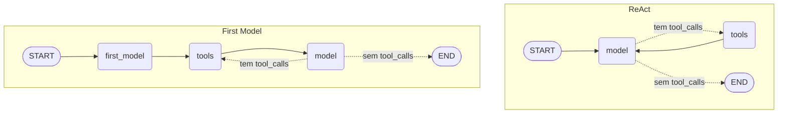

# Desafio 1 · O balcão consulta o catálogo antes de pensar

Código: [balcao_first_model.py](balcao_first_model.py)

Pergunta de teste: “Pastilha de freio dianteira para Onix 2019 1.0. Quanto ficam 2 jogos?”.
Compara o **ReAct padrão** (o modelo decide a primeira busca) com o **First Model**
(um nó Python dispara `buscar_catalogo` sem chamar a LLM).

## Desenho dos grafos



Linha contínua = aresta fixa; tracejada = `tools_condition`.

## Decisões

| Item | Escolha | Por quê |
| --- | --- | --- |
| Catálogo | Dicionário com 4 peças fictícias; chave = termo normalizado | Pedido do enunciado; busca exata e auditável. |
| `buscar_catalogo` | `@tool` com docstring que dá o formato do termo e um exemplo | É a docstring que o modelo lê para montar o argumento. Se não achar, devolve os termos disponíveis para o modelo tentar de novo. |
| `calculator` | A mesma da aula (`ast`, só operadores aritméticos) + `round(…, 2)` | Evita `379.79999999999995` em conta com dinheiro. |
| `model_node` | `SystemMessage` pedindo para fazer toda conta na `calculator` | A pergunta do balcão não pede a calculadora, como a do professor pedia. |
| Argumento do `first_model` | **Não** usa a pergunta inteira; extrai as palavras que existem no vocabulário do catálogo | A pergunta inteira não é chave do dicionário (verificação abaixo). A extração é determinística, sem LLM, e o termo buscado fica visível no log. |
| Tempo | `time.perf_counter` a cada chunk do `stream`: duração do passo e acumulado | Mostra quanto custa cada nó. |

Limite da extração: só funciona com palavras já cadastradas. “Pastilha da
frente” ou “Ônix 19” não viram a chave; aí a busca falha e o modelo, no laço,
pode tentar outro termo.

## Como rodar

```powershell
.venv\Scripts\python "Arquiteturas Multiagentes com LangGraph\aula 18-11\Desafio 1 - O balcao consulta o catalogo antes de pensar\balcao_first_model.py"          # simulado
.venv\Scripts\python "Arquiteturas Multiagentes com LangGraph\aula 18-11\Desafio 1 - O balcao consulta o catalogo antes de pensar\balcao_first_model.py" --real   # gpt-4o-mini
```

## Evidências (22/11/2026, modo SIMULADO)

O “modelo” simulado é um roteiro fixo (busca → calcula → responde). Os tempos
abaixo **não** são latência de LLM; servem só para ver o formato do registro.

```text
Pergunta inteira como termo -> Não encontrado: 'pastilha de freio dianteira para onix 2019 ...
Termo extraído 'pastilha dianteira onix 2019 1.0' -> ... PF-221 · R$ 189,90 · 12 em estoque

=== First Model ===
[     0.8 ms | acum      0.8 ms] Passo 1 | first_model -> ToolCall: buscar_catalogo({'termo': 'pastilha dianteira onix 2019 1.0'})
[     1.5 ms | acum      2.3 ms] Passo 2 | tools       -> Resultado (buscar_catalogo): ... PF-221 · R$ 189,90 · 12 em estoque
[     0.4 ms | acum      2.8 ms] Passo 3 | model       -> ToolCall: calculator({'expression': '2 * 189.90'})
[     1.6 ms | acum      4.4 ms] Passo 4 | tools       -> Resultado (calculator): 379.8
[     0.4 ms | acum      4.8 ms] Passo 5 | model       -> Resposta final: O total fica R$ 379,80

| Grafo        | Passos | Chamadas ao model | 1ª ferramenta   | Até a 1ª busca | Total      |
| ReAct        |   5    |         3         | buscar_catalogo |         4.4 ms |     7.3 ms |
| First Model  |   5    |         2         | buscar_catalogo |         2.3 ms |     4.8 ms |

  [OK] Pergunta inteira NÃO encontra no dicionário
  [OK] Termo extraído encontra PF-221
  [OK] First Model: passo 1 é first_model em poucos ms (0.8 ms < 50)
  [OK] First Model: 1ª ferramenta é buscar_catalogo
  [OK] First Model usa 1 chamada a menos ao model   (versão antiga desta verificação)
  [OK] ReAct: conta saiu da calculadora (379.8)
  [OK] First Model: conta saiu da calculadora (379.8)
  [OK] Respostas finais citam 379,80
```

## Evidências (22/11/2026, `--real`, gpt-4o-mini)

```text
=== ReAct padrão ===
[  2031.2 ms | acum   2031.2 ms] Passo 1 | model       -> ToolCall: buscar_catalogo({'termo': 'pastilha de freio dianteira onix 2019 1.0'})
[     2.2 ms | acum   2033.4 ms] Passo 2 | tools       -> Resultado (buscar_catalogo): Não encontrado: 'pastilha de freio dianteira onix 2019 1.0'. Termos disponíveis: [...]
[  1304.1 ms | acum   3337.5 ms] Passo 3 | model       -> ToolCall: buscar_catalogo({'termo': 'pastilha dianteira onix 2019 1.0'})
[     2.5 ms | acum   3339.9 ms] Passo 4 | tools       -> Resultado (buscar_catalogo): ... PF-221 · R$ 189,90 · 12 em estoque
[  1082.0 ms | acum   4421.9 ms] Passo 5 | model       -> ToolCall: calculator({'expression': '189.90 * 2'})
[     2.3 ms | acum   4424.2 ms] Passo 6 | tools       -> Resultado (calculator): 379.8
[  1195.9 ms | acum   5620.1 ms] Passo 7 | model       -> Resposta final: ... 2 jogos ficam por R$ 379,80.

=== First Model ===
[     1.3 ms | acum      1.3 ms] Passo 1 | first_model -> ToolCall: buscar_catalogo({'termo': 'pastilha dianteira onix 2019 1.0'})
[     2.5 ms | acum      3.8 ms] Passo 2 | tools       -> Resultado (buscar_catalogo): ... PF-221 · R$ 189,90 · 12 em estoque
[   858.3 ms | acum    862.1 ms] Passo 3 | model       -> ToolCall: calculator({'expression': '189.90 * 2'})
[     3.1 ms | acum    865.2 ms] Passo 4 | tools       -> Resultado (calculator): 379.8
[  1420.4 ms | acum   2285.6 ms] Passo 5 | model       -> Resposta final: ... 2 jogos ficam por R$ 379,80.
```

| Grafo | Passos | Chamadas ao model | 1ª ferramenta | Até a 1ª busca | Total |
| --- | --- | --- | --- | --- | --- |
| ReAct | 7 | 4 | buscar_catalogo | 2033,4 ms | 5620,4 ms |
| First Model | 5 | 2 | buscar_catalogo | 3,8 ms | 2285,8 ms |

**Leitura:** no ReAct, a LLM escreveu o termo com “de freio”, que não é chave do
dicionário; a ferramenta devolveu os termos disponíveis e a LLM corrigiu na
segunda tentativa (o laço ReAct se recuperando, como no exemplo da Wikipedia da
aula). Essa correção custou uma chamada extra. O First Model chegou à primeira
busca em 3,8 ms contra 2 s e terminou em menos da metade do tempo. Nos dois, a
conta `189.90 * 2 = 379.8` veio da `calculator`.

**Falha da verificação, não do grafo:** a primeira versão exigia “exatamente 1
chamada a menos” e marcou FALHOU, porque a economia real foi de 2. Passou a
exigir “menos chamadas que o ReAct”. Os tempos variam a cada execução.

## Limites

- **Simulado:** confere as ligações e a origem da conta, não a decisão de uma LLM
  nem a latência real. No ReAct simulado, o “modelo” usa a mesma extração do
  `first_model`; no real, quem escreve o termo é a LLM.
- **ReAct não garante a 1ª ferramenta:** mesmo que a LLM escolha
  `buscar_catalogo`, o grafo não obriga. No First Model, a aresta fixa obriga.
- **Ganho:** no melhor caso do ReAct (termo certo de primeira), os dois têm 5
  passos e o ganho é trocar uma chamada de LLM (~1–2 s) por um nó Python (~1 ms).
  Na execução real o ReAct errou o termo, e o ganho foi maior.
