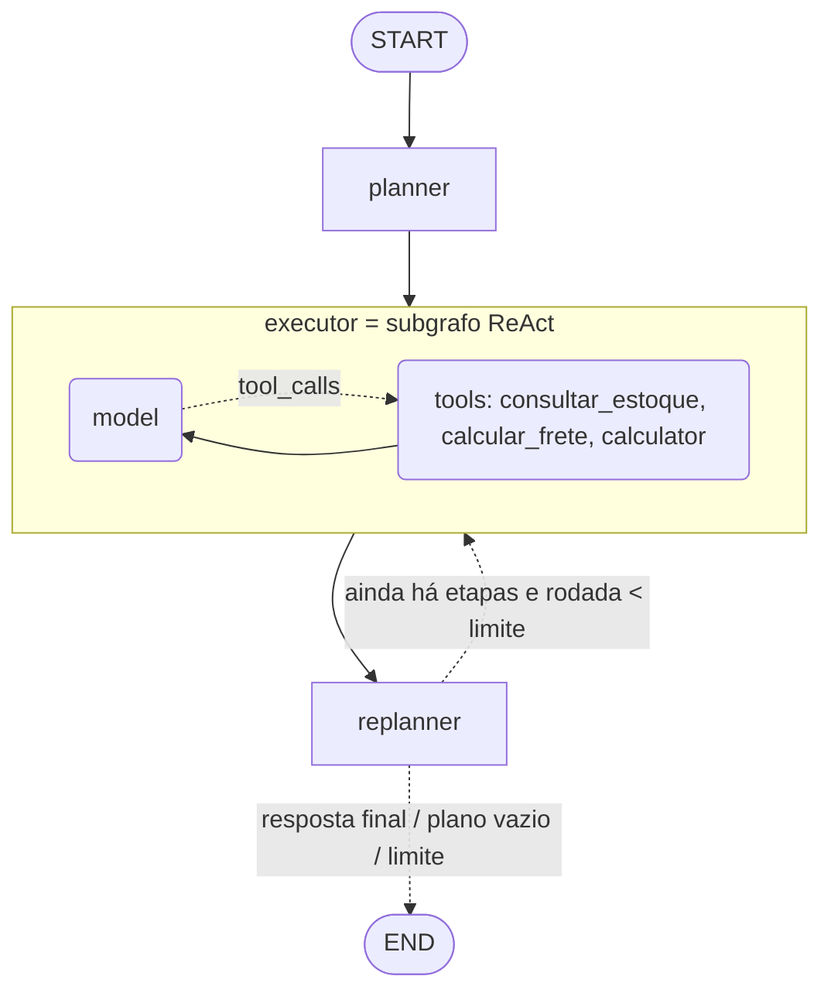

# Desafio 2 · Orçamento em etapas com replanejamento

Código: [orcamento_plan_execute.py](orcamento_plan_execute.py)

Pedido: “Verifique se há 4 velas de ignição VL-30 em estoque, calcule o frete de
2 kg para o CEP 41810-000 e me diga o total com as velas a R$ 32,50 cada.”
Plan-and-Execute pequeno que resolve em etapas e **sempre para**.

Dados fictícios: estoque `{"VL-30": 18, "PF-221": 12}`; frete `25 + kg × 4,5`.
Conta manual: 4 × 32,50 + (25 + 2 × 4,5) = 130,00 + 34,00 = **R$ 164,00**.

## Desenho do grafo



## O que cada nó lê e grava

| Nó | Lê do estado | Grava no estado |
| --- | --- | --- |
| `planner` | `objective` | `plan` (3 a 4 etapas, via `PlanSchema`) |
| `executor` | `plan[0]`, `past_steps`, `objective`, `rodada` | `past_steps` += 1 tupla `(etapa, resultado)`; `rodada + 1` |
| `replanner` | `objective`, `plan`, `past_steps` | `final_response` e `plan=[]` **ou** `plan` com o que falta (via `ReplanDecision`) |

`should_continue_plan` encerra quando há `final_response`, quando o plano
fica vazio ou quando `rodada >= max_rodadas`; senão volta ao `executor`.

## Decisões

| Item | Escolha | Por quê |
| --- | --- | --- |
| Contratos | `PlanSchema` e `ReplanDecision` com `with_structured_output` | Planner e replanner devolvem objetos, não texto para interpretar. |
| Executor | Subgrafo ReAct (`model` ⇄ `ToolNode`) com 3 ferramentas | Uma etapa por vez, com o mesmo laço da aula. |
| `past_steps` | `Annotated[list[tuple], operator.add]` | Cada rodada só acrescenta; o histórico não é apagado. |
| Limite (adaptação didática) | `rodada` e `max_rodadas` no estado, conferidos na aresta condicional | Mesma ideia do `max_iterations` do Reflection: o grafo para mesmo se o replanner nunca concluir. |
| Item inexistente | Prompt do replanner manda concluir quando um resultado mostra que o pedido não pode ser atendido, sem inventar estoque | Evita calcular frete e total de algo que não existe. |
| `calculator` | A da aula + `round(…, 2)` | Valores em reais sem `0.30000000000000004`. |

## Como rodar

```powershell
.venv\Scripts\python "Arquiteturas Multiagentes com LangGraph\aula 18-11\Desafio 2 - Orcamento em etapas com replanejamento\orcamento_plan_execute.py"          # simulado
.venv\Scripts\python "Arquiteturas Multiagentes com LangGraph\aula 18-11\Desafio 2 - Orcamento em etapas com replanejamento\orcamento_plan_execute.py" --real   # gpt-4o-mini
```

Faz três execuções: pedido normal (limite 6), SKU inexistente VL-99 (limite 6)
e pedido normal com limite de 1 rodada.

## Evidências (22/11/2026, modo SIMULADO)

Planner, executor e replanner seguem roteiros fixos; as ferramentas são as reais.

```text
EXECUÇÃO 1 · pedido normal
[PLANNER] Plano com 3 etapas:
   1. Consultar o estoque do SKU VL-30 e verificar se há 4 unidades.
   2. Calcular o frete de 2 kg para o CEP 41810-000.
   3. Calcular com a calculadora o total: 4 x R$ 32.50 + frete.
---> [EXECUTOR] Rodada 1 | Resultado: VL-30: 18 unidades em estoque.
     [REPLANNER] Faltam 2 etapa(s)
---> [EXECUTOR] Rodada 2 | Resultado: Frete de 2.0 kg para o CEP 41810-000: R$ 34.00
     [REPLANNER] Faltam 1 etapa(s)
---> [EXECUTOR] Rodada 3 | Resultado: 164.0
     [REPLANNER] Concluído -> Há 18 unidades em estoque. Frete: R$ 34,00. Total: R$ 164,00.
     Tamanho de past_steps ao longo da execução: [0, 1, 2, 3]

EXECUÇÃO 2 · SKU inexistente (VL-99)
---> [EXECUTOR] Rodada 1 | Resultado: SKU 'VL-99' não encontrado no estoque.
     [REPLANNER] Concluído -> Não há o item VL-99 no estoque, então não calculei frete nem total.

EXECUÇÃO 3 · limite de 1 rodada
---> [EXECUTOR] Rodada 1 | Resultado: VL-30: 18 unidades em estoque.
     [REPLANNER] Faltam 2 etapa(s)
     [PARADA] Limite de 1 rodada(s) atingido sem resposta final.

  [OK] Plano tem 3 ou 4 etapas
  [OK] past_steps cresce 1 tupla por rodada (0, 1, 2, ...)
  [OK] Resposta 1 traz o total R$ 164,00
  [OK] Total veio de uma etapa executada (164 em past_steps)
  [OK] VL-99: resposta diz que não há o item
  [OK] VL-99: não inventa estoque (nenhum 'N unidades')
  [OK] Execuções 1 e 2 dentro do limite (6)
  [OK] Limite 1: parou com exatamente 1 rodada
```

A execução `--real` ainda não foi registrada.

## Limites

- **Simulado:** o planejamento e as decisões do replanner são roteiros por regex;
  provam as ligações, o estado e as três formas de parada, não o raciocínio de
  uma LLM.
- **Parada por limite não responde ao cliente:** na execução 3 o grafo para sem
  `final_response`; o script avisa, mas não há um nó de resposta parcial.
- **Estoque x quantidade:** confere se o SKU existe e mostra o saldo; não há regra
  em Python que bloqueie o orçamento se o pedido passar do estoque.
